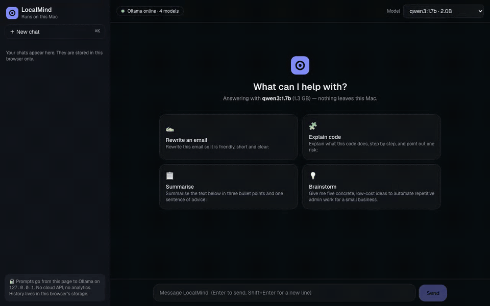
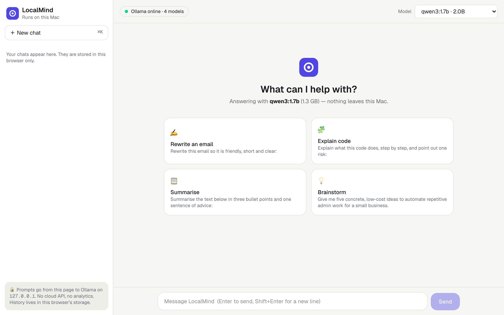
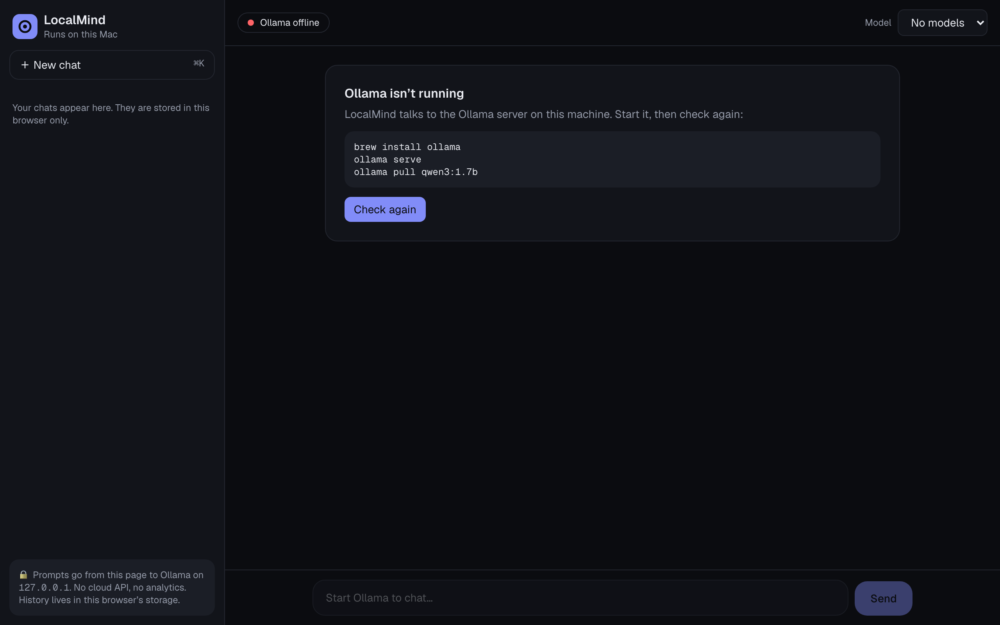
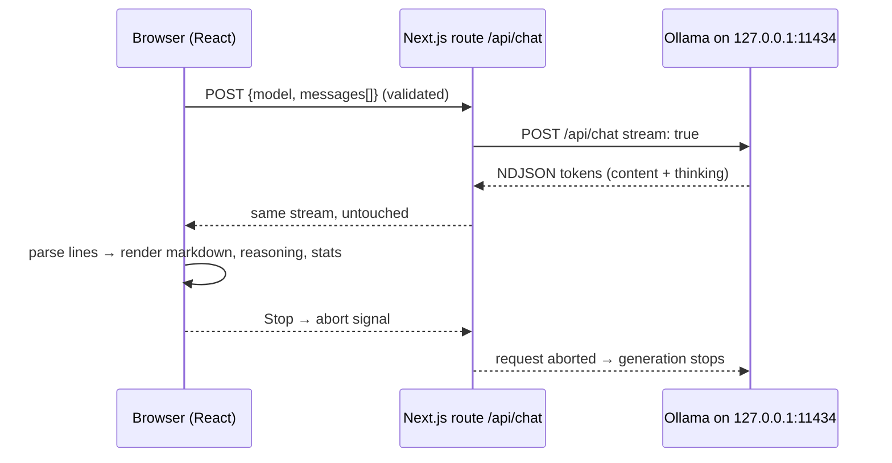

<h1 align="center">LocalMind</h1>

<p align="center">
  <b>A private ChatGPT-style interface for the models on your own Mac.</b><br>
  Next.js + Ollama. Streaming answers, conversation memory, a reasoning view — and nothing leaves <code>127.0.0.1</code>.
</p>

<p align="center">
  <a href="https://github.com/phlppgdfry/LocalMind/actions/workflows/ci.yml"></a>
  
  
  
  <a href="LICENSE"></a>
</p>

<p align="center">
  
</p>
<p align="center"><sub>Real recording: <code>qwen3:1.7b</code> on an Apple-silicon Mac, ~60–85 tokens/s, first token in under half a second.</sub></p>

## Why

Sometimes the text you want help with should not go to a cloud API: a contract, a customer
email, unreleased code. Ollama runs good models locally, but its terminal is not where you want
to rewrite an email. LocalMind is the small, honest UI on top.

## What it does

| | |
| --- | --- |
| **Streams** | Tokens appear as they are generated; **Stop** (or `Esc`) aborts generation on the Mac, not just in the UI. |
| **Remembers** | Every message is sent with the conversation so far, so follow-ups like *"make it more formal"* work. |
| **Shows its reasoning** | Reasoning models (Qwen3, DeepSeek-R1) get a collapsible *Show reasoning* block instead of raw `<think>` text. |
| **Knows your models** | The picker lists what is actually installed (`/api/tags`), smallest first; embedding and cloud-only models are hidden. |
| **Measures** | Under each answer: tokens/s, token count and time to first token, as reported by Ollama. |
| **Keeps history** | Conversations live in this browser's `localStorage` — deletable, newest 50 kept. `⌘K` starts a new chat. |
| **Fails helpfully** | Ollama down or a model missing? You get the exact command to fix it, not a blank screen. |

<table>
  <tr>
    <td width="50%"></td>
    <td width="50%"></td>
  </tr>
  <tr>
    <td align="center"><sub>Start screen (light)</sub></td>
    <td align="center"><sub>Ollama offline (dark) — tells you how to fix it</sub></td>
  </tr>
</table>

## Run it

```bash
brew install ollama
ollama serve                 # keep running
ollama pull qwen3:1.7b       # 1.4 GB; any chat model works

git clone https://github.com/phlppgdfry/LocalMind.git
cd LocalMind
npm install
npm run dev                  # http://localhost:3000
```

Ollama somewhere else? Set `LOCALMIND_OLLAMA_URL=http://192.168.1.20:11434`. (Not `OLLAMA_HOST`:
Ollama uses that variable for its own bind address, often without `http://`.)

## How it works



- `app/api/chat/route.ts` validates the request and pipes Ollama's stream through. Only `role` and
  `content` go back as context; earlier reasoning is not re-sent.
- `app/api/models/route.ts` lists installed chat models and reports whether Ollama is reachable.
- `lib/ollama.ts` holds the pure logic — NDJSON parsing across chunk boundaries, `<think>`
  splitting while still streaming, stats, validation — and is unit-tested.

## Quality

```bash
npm test          # vitest: stream parsing, reasoning split, stats, validation, model filtering
npm run lint
npm run typecheck
npm run build
```

CI runs all four on every push.

## Privacy, precisely

- The browser talks only to the Next.js server you run; that server talks only to Ollama.
- No analytics, no external fonts at runtime (Geist is self-hosted by `next/font`), no cloud model calls.
- History is in `localStorage` of your browser profile. Clear it by deleting chats or site data.
- Do not expose this app to a network: it has no authentication. It is built for `localhost`.

## Roadmap

- [x] Streaming, stop, conversation memory, reasoning view, installed-model picker, history
- [ ] Drop a PDF or text file into the chat and ask about it
- [ ] System prompt presets per conversation
- [ ] Export a conversation as Markdown

## License

MIT
